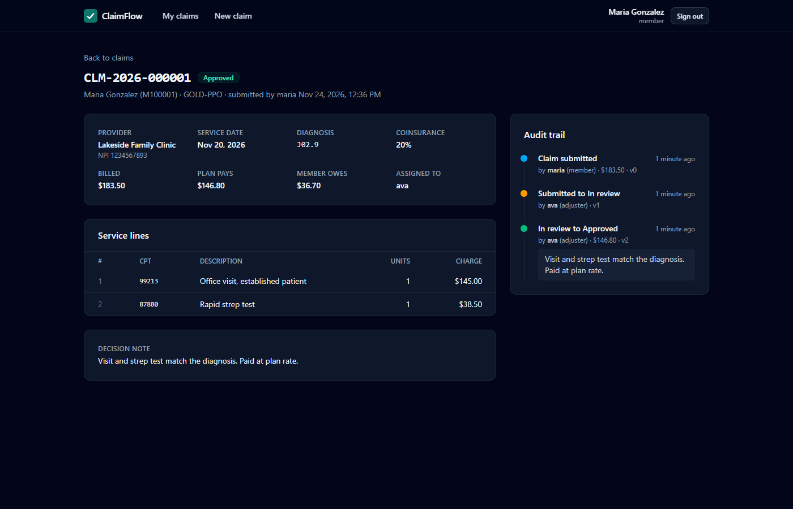
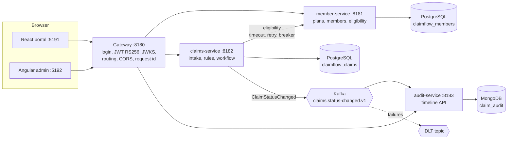
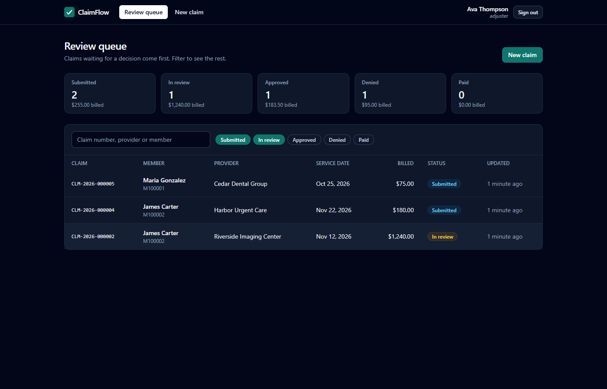
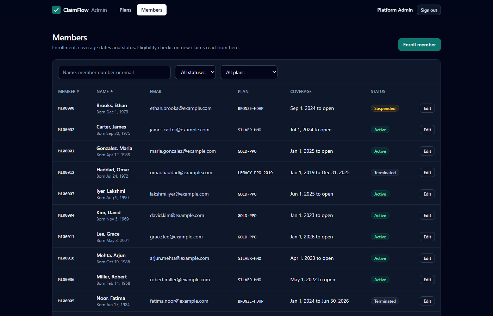

# ClaimFlow

Health insurance claims platform: members submit claims, adjusters review and decide them, and every status change lands in an audit trail. Java 21, Spring Boot 3 microservices, Kafka, PostgreSQL, MongoDB, a React portal and an Angular admin console.



## Why I built this

Most of my work so far has been Angular/React frontends with Python and Node backends. I wanted one project that shows how I would build a claims workflow on the Java stack that healthcare companies run: Spring Boot services that own their own data, a gateway that handles auth, events between services instead of shared tables, and the boring but important parts such as optimistic locking, retries with a circuit breaker, idempotent consumers and a dead letter topic.

## What it does

- **Submit a claim** with service lines (CPT codes, units, charges), a provider NPI and an ICD-10 diagnosis.
- **Validation before anything is saved**: field formats (Bean Validation), then business rules: service date not in the future, timely filing within 365 days, NPI check digit (Luhn with the 80840 prefix), no duplicate procedure lines, a total limit, and a duplicate claim check. All violations come back at once as a `422` ProblemDetail.
- **Eligibility check** against member-service for the date of service, with a 2 s timeout, retry with backoff for 5xx and connection errors, and a circuit breaker. If member-service is down the API answers `503` with `Retry-After` instead of hanging.
- **Status machine** `SUBMITTED -> IN_REVIEW -> APPROVED | DENIED`, `APPROVED -> PAID`. Illegal moves return `409`.
- **Who can do what** is kept apart from the state machine: members only see their own claims, adjusters review and decide, only admins mark claims paid, nobody decides a claim they submitted, and claims above $25,000 need an admin to approve.
- **Optimistic locking end to end**: `GET` returns the JPA `@Version` as an `ETag`, actions must send `If-Match`. A stale version gets `412` with the current ETag, a missing header gets `428`, and a true race at the database still ends as `409`.
- **Payout split** on approval from the plan's coinsurance (plan pays, member owes).
- **Kafka events**: every change publishes `ClaimStatusChanged` keyed by claim id, after the database commit.
- **Audit trail** in MongoDB: the consumer uses the event id as the document id, so redelivered events are ignored. Records that fail are retried and then parked on `claims.status-changed.v1.DLT`, including messages that cannot be deserialized.
- **Timeline API** and an activity feed for staff, filtered by actor, status and time range.
- **Admin console** (Angular) to search, sort and page plans and members, create and edit plans, retire a plan, enroll and update members.

## Architecture



The gateway issues RS256 tokens and publishes its public key at `/.well-known/jwks.json`. Each service is its own OAuth2 resource server: it fetches the JWKS, checks signature, expiry and issuer, and maps the `roles` claim to Spring Security roles. The gateway checks the token too, so an unauthenticated request never reaches a service. claims-service passes the caller's token on to member-service, so member-service applies its own access rules instead of trusting a service account.

| Module | Main pieces |
|---|---|
| `common` | `ClaimStatusChangedEvent` contract, JWT role mapping, `CurrentUser`, paged response, sort allow list |
| `gateway` | Spring Cloud Gateway (WebFlux), login with BCrypt, `NimbusJwtEncoder`, routes in Java config, global request id filter |
| `member-service` | JPA entities `Plan` and `Member`, Specifications for search, Flyway schema, eligibility rules in the domain |
| `claims-service` | `Claim` aggregate with lines and `@Version`, `ClaimRules`, `ClaimPolicy`, `MemberClient` (RestClient + Resilience4j), after-commit Kafka relay |
| `audit-service` | `@KafkaListener` with `ErrorHandlingDeserializer`, `DefaultErrorHandler` + `DeadLetterPublishingRecoverer`, Mongo repository with a custom criteria search |
| `web/claims-app` | React 19, TypeScript, Vite, Tailwind 4, TanStack Query, React Router |
| `web/admin-app` | Angular 22, standalone components, signals, reactive forms, functional interceptor and guard, Tailwind 4 |

## Tech stack

Java 21, Spring Boot 3.5, Spring Cloud Gateway 2025.0, Spring Security (OAuth2 resource server, JWT, BCrypt), Spring Data JPA / Hibernate 6, Flyway, PostgreSQL 16, Spring Kafka, Apache Kafka 4 (KRaft), Spring Data MongoDB, Resilience4j, springdoc OpenAPI, Micrometer/Prometheus, JUnit 5, Mockito, AssertJ, WireMock, Zonky embedded Postgres, Flapdoodle embedded Mongo, spring-kafka-test, React 19, Angular 22, Tailwind CSS 4, Docker, Kubernetes (AKS), GitHub Actions, Jenkins.

## Running it locally (no Docker)

This is exactly how the end to end run below was done on Windows with Git Bash. You need JDK 21, Node 24 and [uv](https://docs.astral.sh/uv/) (only for the Postgres helper).

```bash
export JAVA_HOME=/path/to/jdk-21

# 1. PostgreSQL 16 on port 54340 from the pgserver wheel, creates both databases
uv run --with pgserver python scripts/devdb.py start

# 2. Kafka 4.3.2 in KRaft mode on port 19340, from the official binary
curl -O https://downloads.apache.org/kafka/4.3.2/kafka_2.13-4.3.2.tgz
mkdir -p .local/kafka && tar -xzf kafka_2.13-4.3.2.tgz -C .local/kafka --strip-components=1
scripts/local/kafka.sh &

# 3. MongoDB 7 on port 27340. Uses the mongod that the audit-service tests download,
#    so run ./mvnw verify once first, or point MONGOD at your own binary.
scripts/local/mongo.sh &

# 4. Services with the demo profile (seed data and demo logins)
./mvnw -DskipTests package
scripts/local/run-services.sh

# 5. Frontends
cd web/claims-app && npm install && npm run dev     # http://localhost:5191
cd web/admin-app && npm install && npm start        # http://localhost:5192
```

`run-services.sh` starts the JVMs in GMT because the Postgres build inside pgserver ships without the time zone database and the JDBC driver sends the JVM zone when it connects.

Swagger UI is at `http://localhost:818{1,2,3}/swagger-ui.html` on each service.

### Demo logins

These exist only when the gateway runs with the `demo` profile. They are demo passwords, stored in `gateway/src/main/resources/application.yml` as BCrypt hashes.

| User | Password | Role | Notes |
|---|---|---|---|
| `maria` | `member-demo` | MEMBER | Maria Gonzalez, Gold PPO |
| `james` | `member-demo` | MEMBER | James Carter, Silver HMO |
| `ava` | `adjuster-demo` | ADJUSTER | Reviews and decides claims |
| `admin` | `admin-demo` | ADMIN | Marks claims paid, uses the admin console |

### Docker

`docker compose up --build` should bring up Postgres, Kafka, MongoDB, the four services and both frontends on the same ports. I could not run it, see below.

## Tests

```bash
./mvnw verify                                       # unit + slice tests (surefire) and *IT integration tests (failsafe)
cd web/claims-app && npm run lint && npm run build
cd web/admin-app && npm run lint && npm run build
```

None of the tests need Docker:

- **Unit** (JUnit 5, Mockito): the state machine, payout split, every submission rule, the NPI check digit, the access policy, `ClaimService` with mocks, token issuance, the Kafka listener.
- **Slices**: `@WebMvcTest` with the real security config (401/403, ProblemDetail bodies, `If-Match` handling), `@DataJpaTest` on embedded PostgreSQL 16 (Zonky) with the real Flyway migrations, `@DataMongoTest` on embedded MongoDB 7 (Flapdoodle).
- **Integration**: the gateway with WireMock as the downstream (routing, token relay, CORS, JWKS); claims-service with embedded Postgres, embedded Kafka and WireMock as member-service (full claim lifecycle and the events on the topic, stale ETag, retries on 503, timeout on a slow member-service); the circuit breaker opening and failing fast; audit-service with embedded Kafka and Mongo (ordered timeline, duplicate events dropped, poison message on the DLT).

## Configuration

| Variable | Used by | Default |
|---|---|---|
| `DB_URL`, `DB_USERNAME`, `DB_PASSWORD` | member, claims | `jdbc:postgresql://localhost:54340/claimflow_members` (and `_claims`), `postgres`, empty |
| `KAFKA_BOOTSTRAP_SERVERS` | claims, audit | `localhost:19340` |
| `MONGODB_HOST`, `MONGODB_PORT`, `MONGODB_DATABASE` | audit | `localhost`, `27340`, `claimflow_audit` |
| `MEMBER_SERVICE_URL` | gateway, claims | `http://localhost:8181` |
| `CLAIMS_SERVICE_URL`, `AUDIT_SERVICE_URL` | gateway | `http://localhost:8182`, `http://localhost:8183` |
| `JWT_ISSUER` | all | `http://localhost:8180` |
| `JWK_SET_URI` | services | `http://localhost:8180/.well-known/jwks.json` |
| `JWT_TTL` | gateway | `PT1H` |
| `CLAIMFLOW_JWT_PRIVATEKEY`, `CLAIMFLOW_JWT_PUBLICKEY` | gateway | unset, which generates a key at startup (local only) |
| `CORS_ALLOWED_ORIGINS` | gateway | `http://localhost:5191,http://localhost:5192` |
| `SPRING_PROFILES_ACTIVE=demo` | gateway, member | adds demo logins and seed data |
| `claimflow.claims.*` | claims | timely filing 365 days, max claim $100,000, adjuster approval limit $25,000 |

## Results

All numbers are from my machine (Windows 11, all services, Kafka, Postgres and Mongo on the same laptop).

- `./mvnw verify`: 129 tests pass (105 unit and slice tests, 24 integration tests), 3 min 18 s for a clean build of all five modules. Both frontends pass `npm run lint` and `npm run build`.
- End to end through the gateway against real PostgreSQL 16, Kafka 4.3.2 and MongoDB 7: Maria submitted a claim, Ava started review and approved it, a second approval with the old ETag got `412`, and the timeline showed all three events. The screenshots in `docs/` are from that run.
- Load test (`loadtest/gateway-load.mjs`, Node, no extra tools), through the gateway with JWT validation at both the gateway and the service:

| Scenario | Requests | Concurrency | Throughput | p50 | p95 | p99 | Errors |
|---|---|---|---|---|---|---|---|
| Read: claim list 80%, claim detail 20% (30 s) | 58,600 | 20 | 1,953 req/s | 8.9 ms | 19.2 ms | 28.6 ms | 0 |
| Write: submit claim (eligibility call + insert + Kafka) | 300 | 10 | 114 req/s | 73.8 ms | 180.2 ms | 257.8 ms | 0 |

  After the write test the audit collection held 310 events for 305 claims, one per change, none lost.

| Review queue (adjuster) | Admin console (Angular) |
|---|---|
|  |  |

## What was not run

- **Docker, docker-compose and Kubernetes**: there is no Docker on the machine I built this on. The Dockerfiles, `docker-compose.yml` and `k8s/` manifests are written to work but have not been built or applied.
- **Azure**: the manifests target AKS (application routing ingress, ACR images, Azure Database for PostgreSQL in the config map), and the Jenkinsfile pushes to ACR and deploys to AKS. None of that was deployed.
- **CI**: `.github/workflows/ci.yml` and the `Jenkinsfile` have not run yet.
- The frontends have lint and type checks but no unit tests.

## What I'd do next

- Transactional outbox for the Kafka events. Today the event is sent after commit, so a crash between commit and send loses that one event; the log line is the only trace.
- Replace the demo login with Entra ID (or any OIDC provider). The services would not change since they already validate JWTs from a JWKS URL.
- A unique index for the duplicate claim rule, so two identical submissions at the same moment cannot both pass the check.
- Deductible and out of pocket tracking per member per plan year; approval currently applies coinsurance only.
- Testcontainers based tests in CI, OpenTelemetry tracing across the gateway and services, and contract tests for the event schema.
- Frontend tests (Vitest for React, Angular's test runner for the admin app) and a Playwright run of the claim flow.
